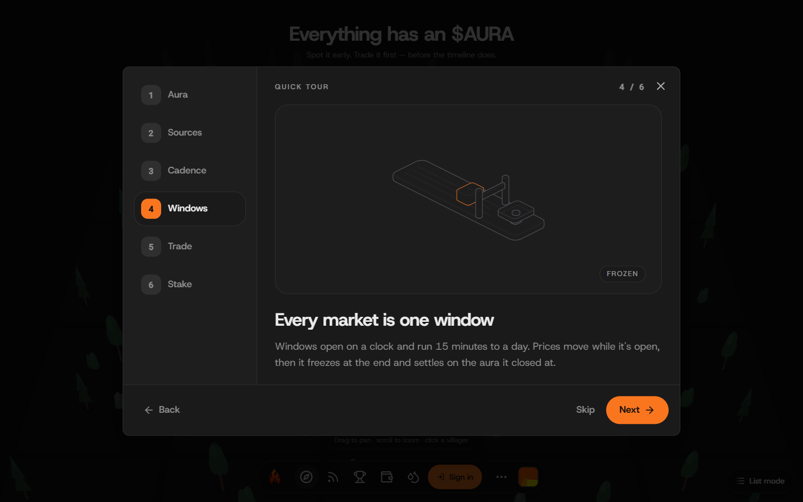

# Aura — The Internet Aura Market

[](https://github.com/credibble/aura/actions/workflows/ci.yml)

> **Trade the trend line of the internet's mood.**
> Aura turns real online attention into a live, AI-scored on-chain index — then
> lets anyone trade prediction markets on where each name's aura goes next.

**[▶ Live app](https://app.auramarkets.world)** ·
**[🎤 Pitch video](https://youtu.be/bWrAWrAhGoA)** ·
**[🎬 Technical demo](https://youtu.be/E2GSJJVkTLs)** ·
**[⛓ Contracts on Monad testnet](#on-chain)** ·
**[🧩 Sponsor deep dives](#built-with)** ·
**[𝕏 @auramarkets_](https://x.com/auramarkets_)**


Every market is one **handle** — a person, project, coin or brand — and one time
**window**. The handle's index, its **aura**, is scored by an AI from the
handle's own scoped sources (news RSS, X, Reddit, YouTube, GitHub, per-user OAuth
connections) and written on-chain. Each window asks one question: **does this
handle's aura close higher or lower?**

---

## Contents

- [Try it in two minutes](#try-it-in-two-minutes)
- [Why it's different](#why-its-different)
- [How it works](#how-it-works)
- [Built with](#built-with)
- [On-chain](#on-chain)
- [Known limitations & what's next](#known-limitations--whats-next)
- [Repository layout](#repository-layout)
- [Where the data comes from](#where-the-data-comes-from)
- [The aura → market decision path](#the-aura--market-decision-path)
- [Run it locally](#prerequisites) · [Environment variables](#environment-variables) · [Verification & CI](#verification--ci)
- [Chainlink CRE workflows](#chainlink-cre-workflows) · [Redeploy runbook](#redeploy-runbook) · [The adapter contract](#the-adapter-contract) · [Docs & conventions](#docs--conventions)

---

## Try it in two minutes

Nothing to install — it runs on Monad testnet with test money.

1. **Open [app.auramarkets.world](https://app.auramarkets.world).** The home page
   is the **Atlas**: every handle is a villager in its category's district. Bigger
   villagers have more aura; 🔥 marks the biggest movers. Drag to pan, scroll or
   pinch to zoom. **How it works** walks the whole loop in six steps.
2. **Sign in with your email.** Privy creates an embedded wallet for you — no
   extension, no seed phrase. (Your first transaction needs a little testnet MON
   for gas: [faucet.monad.xyz](https://faucet.monad.xyz).)
3. **Click a villager** to open its market: the aura chart (hover a point to read
   the AI's one-line *why it moved*), the live window, YES/NO prices, the order
   book and the handle's source feed.
4. **Tap "Get 1,000 test USDC"** in the trade ticket, then **buy YES or NO**. Each
   trade is a real, user-signed transaction on Monad testnet.
5. **Watch the window close.** It freezes at the end, settles on the aura it closed
   at, and winning shares claim 1 USDC each.



## Why it's different

- **The asset is momentum, not an event.** Prediction markets usually price
  "will X happen by date Y" — slow to resolve, easy to dispute. Aura prices the
  continuous trend of attention, in windows from 15 minutes to a day.
- **The model advises; code decides.** The AI returns a direction, a magnitude in a
  ±5–20% band and a one-line rationale. Code scales that by an evidence weight
  (credibility × volume × reach) and clamps it, so a confident take on one weak
  article moves the index far less than a broad, high-reach story.
- **Every move is explained and replayable.** The memo is written on-chain with the
  move. Each tick is hashed over the exact items the model saw, its raw reply and
  the applied percent: re-fetch the evidence, re-run the prompt, compare the hash.
- **No observation, no settlement.** A window with no aura observation is left to
  VOID and refunds traders, instead of resolving on a stale number.

## How it works

```
  scoped sources ──▶ aura engine ──▶ on-chain aura ──▶ market windows
  (RSS · APIs ·     (AI scores      (Handle.updateAura   (MarketMaker LMSR,
   OAuth feeds)      text + reach)   + AuraHistory)       YES/NO per slot)
        ▲                                   │
        └────────── indexer (Envio) ────────┘  every entity the UI + oracle read
```

1. **Ingest.** Per-handle adapters pull real items with real reach (author, likes,
   replies, views). Each source is a JSON config stored on-chain in
   `Handle.sources[]`. Adapters fail closed without credentials and never invent a
   metric.
2. **Score.** The aura engine builds the signal (normalized volume + engagement +
   item texts), asks the AI for direction + magnitude + memo, scales it by
   evidence, writes the new aura **on-chain**, and pushes it over WebSocket.
3. **Trade.** The window engine opens a market window per handle per slot. Prices
   come from an LMSR market maker plus an order book, backed by the auraLP pool;
   early believers can stake $AURA on a handle and earn a cut of every window that
   settles.
4. **Settle.** At `windowEnd` the window resolves from the aura series and the next
   slot opens in the same tick, so a handle always has a live window.

The full step-by-step, with what is and isn't deterministic, is
[the decision path](#the-aura--market-decision-path) below.

## Built with

| | What it does in Aura | Where | Deep dive |
|---|---|---|---|
| **Monad** (testnet) | Every contract, every trade, every aura write and settlement. | [`smart-contracts/`](smart-contracts/) | [On-chain](#on-chain) |
| **Envio HyperIndex** | The only source of on-chain state for the app, the oracle and CRE — GraphQL plus live WebSocket subscriptions. | [`indexer/`](indexer/) | [envio-bounty.md](docs/envio-bounty.md) |
| **Chainlink CRE** | The protocol's cron jobs — staking rewards and handle graduation — as consensus-verified workflows. | [`cre/`](cre/) | [cre-bounty.md](docs/cre-bounty.md) |
| **Kimi K2** (Moonshot) | Scores each tick from the items' text: direction, magnitude, rationale. | [`oracle/`](oracle/) | [Article on Medium](https://medium.com/@dev_arogundade/using-kimi-k2-to-turn-internet-attention-into-a-verifiable-tradable-on-chain-index-ee92241a18bb) · [kimi-in-aura.md](docs/kimi-in-aura.md) |
| **Privy** | Email sign-in with an embedded wallet; every trade still user-signed. | [`app/`](app/) | [privy-bounty.md](docs/privy-bounty.md) |

Also: TanStack Start + Vite + Tailwind 4 · NestJS + Socket.IO · Postgres + Redis ·
Cloudinary · Hairline line figures.

## On-chain

Monad testnet (chain id `10143`). Addresses from
[`deployments.json`](smart-contracts/deployments/deployments.json).

| Contract | Address |
|---|---|
| HandleFactory | [`0x56cE…8119`](https://testnet.monadexplorer.com/address/0x56cE5569612418A0829f65220dAeCc93b38F8119) |
| MarketMaker (LMSR) | [`0xa66c…3E02`](https://testnet.monadexplorer.com/address/0xa66c93D8BC2AF554C5E5bdACfFC3210Ad2863E02) |
| OrderBook | [`0xfE4d…48A`](https://testnet.monadexplorer.com/address/0xfE4d4AAb7B2D2239039623F0a8a5087a15B5248A) |
| OracleFactory | [`0x3c2f…1326`](https://testnet.monadexplorer.com/address/0x3c2f7c24d86D7F2F2344A4Ea3466F5F2cd4F1326) |
| Pool (auraLP) | [`0x861C…0cd9`](https://testnet.monadexplorer.com/address/0x861C853853ae2cd05E98A3472074a3f618Ac0cd9) |
| RevenueSharing | [`0xFaF5…47B6`](https://testnet.monadexplorer.com/address/0xFaF5551Bbe0Be5B990D53A43869Cd293d8C547B6) |
| AURA token | [`0x69F5…26DB`](https://testnet.monadexplorer.com/address/0x69F5AAe07E7839f67F7fCDA81C3319AB996926DB) |
| USDC (test) | [`0x2a23…35B2`](https://testnet.monadexplorer.com/address/0x2a2397e18Acb79E18BedA8b9B9365D4e1a1B35B2) |
| Relayer (aura writes + settlement) | [`0x09fd…E082`](https://testnet.monadexplorer.com/address/0x09fd7bbE0422a864a01BD906A8A8E8F88bcdE082) |

Each handle also has its own `Handle` and `Stake` contract, listed per handle in
`deployments.json`.

## Known limitations & what's next

- **Single relayer.** One key pushes aura and submits resolutions. The fix is a
  multisig or a challenge window on `submitResolution` — a deployment decision.
- **Evidence hash is off-chain.** Each tick's hash is logged and pushed over the
  WebSocket, not yet committed in the on-chain `ResolutionReceipt`. That needs the
  next contract revision.
- **Testnet only.** Collateral is a public mock USDC; there is no mainnet deploy.
- **One non-deterministic step.** The AI score is advisory and fenced on every side
  (band, evidence weight, clamp, hash), but re-running a prompt can still differ.

Next: the contract revision that commits the evidence hash into the resolution
receipt, and a multisig (or challenge window) in place of the single resolver.

## Repository layout

| Path | What it is | Port |
|---|---|---|
| `app/` | The product — TanStack Start + Vite + Tailwind 4 + Radix + TanStack Query/Router + viem. Reads on-chain state from the indexer (HTTP + WS subscriptions), backend data from the oracle API, exact values from the chain. | `5173` |
| `oracle/` | NestJS backend — social/feeds API, handle creation + profile writes, Cloudinary uploads, Socket.IO gateway, the AI aura engine, and the market-window job engine. | `4000` (`/v1`, `/socket.io`) |
| `indexer/` | Envio HyperIndex — every on-chain entity (handles, windows, trades, orders, the auraLP vault, staking). A pure log consumer: the contracts emit the state. | `8080` (`/v1/graphql`; Hasura console, password `testing`) |
| `smart-contracts/` | Solidity protocol (Handle/HandleFactory, MarketMaker LMSR, Oracle/OracleFactory, Pool, Stake, RevenueSharing, OrderBook) + Hardhat tests + the deploy tooling. | — |
| `packages/` | Shared workspace — `@aura/contracts` (types + slot math), consumed by the oracle and scripts. | — |
| `cre/` | Chainlink CRE project — the stake-reward + graduation workflows. Their reads (vault list, graduation candidates) come from the Envio indexer's `/v1/graphql`, the same source as the app. | — |

## Where the data comes from

| Source | Used for | Env |
|---|---|---|
| **Envio indexer** (GraphQL + WebSocket) | All on-chain state: handles, windows, trades, price points, orders + fills, pool/stake snapshots. Paging/sorting/filtering happen *in the query*; live surfaces subscribe over `ws://` and stand their polling down while the socket is up. | `VITE_INDEXER_URL` |
| **Oracle REST** | Backend-owned data: posts/feeds, comments, likes, reposts, bookmarks, follows, subscriptions, notifications, handle/profile writes, OAuth connections. | `VITE_API_BASE` |
| **Chain** (viem, Monad testnet) | Anything that must be exact and fresh: balances, allowances, outcome shares, vault stats, and **every write**. | `VITE_*_ADDRESS` |
| **Socket.IO** (oracle) | The oracle pushes `aura`, `feed`, `social.*`, `window*`, and `notification` events; the app patches its caches in place. | same as oracle |

**Live updates are subscriptions; polling is the fallback.** Queries without an
event source (positions, open orders, pool/stake stats) poll through the poll
registry, and a poll only runs while its surface is on screen.

## The aura → market decision path

One tick, and what constrains it:

| Step | Where | Deterministic? |
|---|---|---|
| Fetch scoped sources → raw items (+ engagement) | `oracle/adapters/*` | yes |
| Build signals: normalized volume + engagement + item texts + per-source context/topic | `AuraEngineService.signalFor` | yes |
| AI answer: **direction + magnitude (percent, ±5–20) + memo** | `KimiAiModel.scoreWithSummary` | **no** (the only non-deterministic step) |
| Evidence weight: credibility-weighted volume × reach, clamped to `[0.25, 1]` | `evidenceWeight` | yes |
| Applied move: AI magnitude × evidence weight, re-clamped to ±5–20%; points floor ≥ 1 unit | `AuraEngineService.appliedPercent` | yes |
| Memo → on-chain (`Handle.updateAura`) + audit hash → WS | `ChainGateway`, `publishAura` | yes |

- **The model never decides size alone.** A confident answer off one weak item
  moves the index far less than a broad, high-reach story.
- **Nothing resolves without an observation.** A window with no aura observation
  is deliberately left unsettled (the market's grace window VOIDs it and refunds
  traders) rather than resolving YES on an unchanged series. The aura engine keeps
  ticking even without brand-new items — it scores the most recent items — or the
  window engine would starve.
- **Every tick is replayable.** `hashTick` commits to the handle, timestamp, base
  level, the item ids the model saw, its raw reply, and the applied percent.

## Prerequisites

- **Node.js 20+** (the indexer CI job uses Node 22).
- **Docker** — the indexer (HyperSync sync + GraphQL) and the oracle stack run in
  containers.
- **WSL** on Windows — the Envio CLI addon is linux/darwin only.
- **A funded Monad testnet wallet** for deploy/relayer duties (Monad's gas floor
  is ~100 gwei).
- **CRE CLI** (`cre`) + a Chainlink account, only for the `cre/` workflows.

## Quickstart

```bash
# 0. deps (workspace root)
npm install

# 1. indexer: HyperSync sync + the GraphQL API (needs Docker; WSL on Windows)
cd indexer && npm install
cp .env.example .env                # ENVIO_API_TOKEN + ENVIO_RPC_URL
npm run codegen && npm run dev      # GraphQL on :8080

# 2. contracts: deploy + verify wiring + sync the indexer config + seed handles
cd ../smart-contracts
PRIVATE_KEY=$RELAYER_PK ORACLE_PRIVATE_KEY=$RELAYER_PK \
  npx hardhat run scripts/deploy.ts --network monadTestnet
npx hardhat run scripts/verify-deploy.ts --network monadTestnet
node scripts/sync-indexer.mjs --write
PRIVATE_KEY=$RELAYER_PK ORACLE_PRIVATE_KEY=$RELAYER_PK \
  npx hardhat run scripts/seed-handles.ts --network monadTestnet

# 3. oracle: API + worker + postgres + redis (migrations run on boot)
cd ../oracle && docker compose up -d --build --force-recreate \
  postgres redis oracle-migrate oracle-api oracle-worker

# 4. app
cd ../app && npm run dev             # http://localhost:5173
```

Copy `oracle/.env.example` → `oracle/.env` and `app/.env.example` → `app/.env`
first, and paste the addresses printed by `sync-indexer.mjs` into `oracle/.env`.
**Never commit the real `.env` files** — they hold the relayer key.

> Prefer the orchestrator: `smart-contracts/scripts/deploy-all.mjs` runs steps
> 1–3 and 5 and prints the env lines. See the [redeploy runbook](#redeploy-runbook).

## Environment variables

Each deployable has an `.env.example` with the full list and comments. The ones
you'll touch most:

| Variable | Where | Purpose |
|---|---|---|
| `VITE_INDEXER_URL` | `app` | Envio GraphQL endpoint (`http://localhost:8080/v1/graphql`) |
| `VITE_API_BASE` | `app` | Oracle REST base, includes `/v1` (`http://localhost:4000/v1`) |
| `VITE_*_ADDRESS` | `app` | Contract addresses from `deployments/deployments.json` |
| `VITE_PRIVY_APP_ID` | `app` | Auth + embedded wallet |
| `ORACLE_PRIVATE_KEY` | `oracle` | The relayer that pushes aura and settles windows |
| `HANDLE_OWNER_PRIVATE_KEY` / `HANDLE_FACTORY_ADDRESS` | `oracle` | Server-signed handle creation |
| `INDEXER_URL` | `oracle` | Same indexer endpoint |
| `KIMI_VIA_0G` + `ZERO_G_API_KEY` | `oracle` | Route AI completions through the 0G router (`kimi-k2.5`) instead of Moonshot |
| `AURA_AI_MIN_INTERVAL_MS` | `oracle` | Minimum gap between AI scoring calls per handle |
| `WINDOW_EARLY_SETTLE` | `oracle` | `false` (default): windows trade their full length |

## Verification & CI

Everything runs **without a wallet or an RPC**:

```bash
cd app
node scripts/check-writes.mjs           # parses every ABI + encodes all write paths
node scripts/check-routes.mjs           # fetches every page, asserts 200 + content
node scripts/check-indexer-fields.mjs   # app queries vs the indexer schema
npx tsc --noEmit
```

```bash
cd oracle && npm test          # unit suite (vitest)
cd oracle && npm run test:e2e  # builds + drives dist/main.js over HTTP
cd smart-contracts && npx hardhat test
cd indexer && npx envio codegen   # config + schema compile (linux/darwin; WSL on Windows)
```

`check-writes.mjs` fails on ABI drift; `check-indexer-fields.mjs` fails when an
entity/field the app selects is missing from `indexer/schema.graphql`. The oracle
e2e asserts health/readiness shape, hardening headers, 401 on guarded writes, and
that a write burst never 5xx's.

[`.github/workflows/ci.yml`](.github/workflows/ci.yml) runs all of the above on
every push and pull request.

## Chainlink CRE workflows

`cre/` holds two cron workflows — **stake-reward** (top up underfunded AURA
vaults) and **graduation** (graduate handles above an aura floor). Both read from
the Envio indexer and write EVM through consensus-verified reports.

Run the **receiver-free dry run** from the project root (`cre/`):

```bash
cd cre
cre workflow simulate reward     --target local-simulation --non-interactive --trigger-index 0
cre workflow simulate graduation --target local-simulation --non-interactive --trigger-index 0
```

`--target local-simulation` exercises the real indexer read + decision path and
returns a labeled result — no consumer contract, no transaction. The production
target is `testnet-settings` (Monad testnet); it fails closed without the deployed
consumer address in `config.json`. Deploy with
`cre workflow build|simulate|deploy --target testnet-settings`.

## Redeploy runbook

Prefer the orchestrator (runs steps 1–3 and 5, prints the env lines):

```bash
cd smart-contracts
PRIVATE_KEY=$RELAYER_PK ORACLE_PRIVATE_KEY=$RELAYER_PK node scripts/deploy-all.mjs
# (add --skip-indexer to compile/deploy only the contracts + seed)
```

By hand: deploy → `verify-deploy.ts` (proves `OracleFactory.signer == relayer`) →
`sync-indexer.mjs --write` → indexer `codegen && dev` → `seed-handles.ts` → point
the oracle at the new addresses and
`docker compose up -d --build --force-recreate oracle-api oracle-worker`.

> `ORACLE_PRIVATE_KEY` must equal the address `OracleFactory` was deployed with
> (its `signer`) **and** the handle's `auraUpdater`, or settlement and aura writes
> revert silently.

## The adapter contract

Naming: **`<Platform><Purpose>Adapter`**, grouped by credential type.

| Folder | Credential | Adapters | Reads |
|---|---|---|---|
| `adapters/public/` | none | `RssFeedAdapter` · `RedditSearchAdapter` · `HackerNewsSearchAdapter` | open feeds + search APIs |
| `adapters/api/` | app key / token | `XSearchAdapter` · `YouTubeChannelAdapter` · `GitHubProfileAdapter` · `TwitchChannelAdapter` | **other people's** public data |
| `adapters/connections/` | per-user OAuth | `SpotifyConnectAdapter` · `InstagramConnectAdapter` · `FacebookConnectAdapter` · `LinkedInConnectAdapter` · `ShopifyConnectAdapter` | **the connected account's own** data |

Every adapter **emits items** (not just metrics), **carries reach** on each item,
**never synthesizes a number**, **fails closed without credentials**, and is **one
code path per protocol, configured per source**.

## Docs & conventions

- [`AGENTS.md`](./AGENTS.md) — the deeper working notes: the WS event map, the
  adapter contract in full, the redeploy runbook, and local-setup gotchas.
- [`indexer/README.md`](./indexer/README.md) — the indexer's own notes.
- **Copy & voice:** slang lives in the chrome, never in the ledger — one quip per
  surface, never on numbers, funds, or errors. Recurring strings live in
  `app/src/lib/voice.ts`.
